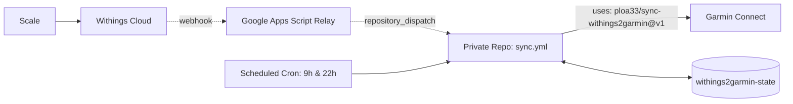

# Withings → Garmin Connect

[](https://github.com/marketplace/actions/withings-to-garmin-connect-sync)
[](https://github.com/ploa33/sync-withings2garmin/releases)
[](https://github.com/ploa33/sync-withings2garmin/actions/workflows/ci.yml)
[](https://buymeacoffee.com/ploa33)

Sync weigh-ins and body metrics from any **Withings Scale** (Body, Body+, Body Smart, Body Scan, Body Comp, Body Cardio) to **Garmin Connect** in real-time with GitHub Actions — 100% free, serverless, and private.

**Supported Metrics:** Weight, Body Fat %, Muscle Mass, Body Water %, Bone Mass.

---

## 🚀 Quick Setup (5 minutes)

### 1. Create your private repository

Click the button below to generate your private repository from this template:

[](https://github.com/new?template_name=sync-withings2garmin&template_owner=ploa33)

> [!IMPORTANT]
> Your repository **must be set to Private** to protect your health data and credentials. The workflow will refuse to execute on public repositories.

---

### 2. Configure GitHub Secrets

In your newly created repository, navigate to **Settings → Secrets and variables → Actions** and add the following repository secrets:

| Secret | Description | Where to find it |
|---|---|---|
| `GARMIN_EMAIL` | Garmin Connect account email | Your Garmin login |
| `GARMIN_PASSWORD` | Garmin Connect account password | Your Garmin login |
| `WITHINGS_CLIENT_ID` | Withings developer application Client ID | [Withings Developer Dashboard](https://developer.withings.com/dashboard/) |
| `WITHINGS_CLIENT_SECRET` | Withings developer application Client Secret | [Withings Developer Dashboard](https://developer.withings.com/dashboard/) |
| `WEBHOOK_URL` | *(Optional)* Google Apps Script URL for instant sync | See [Real-Time Sync](#-real-time-sync-optional) below |

> [!NOTE]
> **No manual token generation or curl command required.** The action handles the entire OAuth authorization flow automatically in the next step.

---

### 3. First Run — Authorize Withings (No terminal needed)

1. In your repository, go to the **Actions** tab → **Withings → Garmin Sync** → click **Run workflow** (leave all input fields blank).
2. Once the initial run finishes, open the workflow run and view the **Job Summary** tab. Click the provided **Withings Authorization link** and grant access.
3. After approving, look at your browser address bar. Copy the value of `code=` from the URL:
   ```text
   http://localhost:8080/?code=abcdef0123456789...&state=init
   ```
4. Back in the **Actions** tab, click **Run workflow** again, paste your code into the **`withings_code`** input field, and start the run.

The action automatically exchanges the authorization code for OAuth tokens, saves them securely to the private `withings2garmin-state` branch, and uploads your weigh-ins.

> **Tokens rotate automatically on every run from now on — zero maintenance required.**

<details>
<summary><b>🔐 Garmin 2FA / MFA (First Login Only)</b></summary>

If your Garmin account has **two-factor authentication (2FA/MFA)** enabled:
- When running step 3 above, also provide your current verification code (authenticator app TOTP or email OTP) in the **`garmin_mfa_code`** field.
- The session is saved to your private state branch, so MFA is never needed again unless Garmin expires your session.

</details>

---

## ⚡ Real-Time Sync *(Optional)*

By default, the workflow runs twice daily (**09:00 & 22:00**) as a scheduled safety net. To upload weigh-ins **instantly** the moment you step off your scale, configure this lightweight Google Apps Script relay:

<details>
<summary><b>Click to expand: Setup Google Apps Script Webhook Relay (2 minutes)</b></summary>

Withings sends an HTTP webhook when a new weigh-in occurs. Google Apps Script serves as a free, serverless bridge to trigger your GitHub Actions workflow immediately.

1. **GitHub Fine-Grained Personal Access Token (PAT):**
   - Go to [GitHub Settings → Personal Access Tokens → Fine-grained tokens](https://github.com/settings/personal-access-tokens/new).
   - **Repository access:** *Only select repositories* → select your private sync repository.
   - **Permissions:** *Repository permissions* → **Contents: Read and write**.
   - **Expiration:** Choose **1 year** (or max allowed).

2. **Google Apps Script:**
   - Open [script.google.com](https://script.google.com/) and create a **New project**.
   - Replace the default code with:

   ```javascript
   const REPO  = "YOUR_GITHUB_USERNAME/YOUR_PRIVATE_REPO"; // e.g. "octocat/my-withings2garmin"
   const TOKEN = "github_pat_11A...";                      // Fine-Grained PAT from Step 1

   // doPost: Triggered by Withings webhook on each weigh-in -> fires GitHub Action
   function doPost(e) {
     UrlFetchApp.fetch(`https://api.github.com/repos/${REPO}/dispatches`, {
       method: "post",
       headers: { Authorization: `Bearer ${TOKEN}`, Accept: "application/vnd.github+json" },
       payload: JSON.stringify({ event_type: "withings_sync" }),
       muteHttpExceptions: true,
     });
     return ContentService.createTextOutput("OK");
   }

   // doGet: OAuth callback helper for initial setup (forwards code automatically)
   function doGet(e) {
     const code = e && e.parameter && e.parameter.code;
     if (code) {
       UrlFetchApp.fetch(`https://api.github.com/repos/${REPO}/dispatches`, {
         method: "post",
         headers: { Authorization: `Bearer ${TOKEN}`, Accept: "application/vnd.github+json" },
         payload: JSON.stringify({ event_type: "withings_sync", client_payload: { code } }),
         muteHttpExceptions: true,
       });
       return ContentService.createTextOutput(
         "✅ Withings authorized! Your GitHub Action will now exchange the code and sync. You can close this tab."
       );
     }
     return ContentService.createTextOutput("Withings2Garmin Webhook Relay Active");
   }
   ```

3. **Deploy Web App:**
   - Click **Deploy → New deployment**.
   - Select type: **Web app** (gear icon).
   - Execute as: **Me**.
   - Who has access: **Anyone** *(required for Withings servers to call it)*.
   - Click **Deploy** and copy the generated **Web app URL** (`https://script.google.com/macros/s/.../exec`).

4. **Add Secret:**
   - In your private repository, save this URL under the **`WEBHOOK_URL`** secret.

On the next workflow run, the action registers this callback URL with the Withings Notify API automatically.

> [!TIP]
> If you set your Google Apps Script URL as the **Callback URL** in the Withings Developer Portal, step 3 of the initial setup becomes fully automatic — zero copy-pasting of authorization codes needed!

</details>

---

## 🛠️ Architecture & Reliability



### Security & Reliability Built-in

- **Public Repository Guard:** An automated check at the top of the action halts execution immediately if your repository is public, preventing unintended exposure of health metrics and credentials.
- **Dynamic Token Masking:** All Withings authorization codes, access tokens, and refresh tokens are masked in GitHub Actions runner logs (`::add-mask::`) as soon as they are loaded into memory.
- **Strict Concurrency Serialization:** Workflows use `concurrency: { group: withings2garmin-sync, cancel-in-progress: false }` to queue runs sequentially, preventing race conditions on rotated OAuth tokens when a webhook and a cron job trigger simultaneously.
- **Isolated Developer Workflows:** Internal CI and release workflows are scoped exclusively to the upstream repository (`if: github.repository == 'ploa33/sync-withings2garmin'`), preventing extraneous runs on user template copies.
- **Automatic Upstream Updates:** By referencing `ploa33/sync-withings2garmin@v1`, your workflow receives new bug fixes and improvements automatically on every run.
- **Single-Commit State Branch:** Tokens and Garmin session state are saved to a standalone orphan branch (`withings2garmin-state`), keeping your repository history clean and free of token commits.

---

## 🔒 Privacy & Self-Hosted

- **100% Self-Hosted:** The entire sync runs within your own private GitHub account using standard GitHub Actions runners.
- **Zero Third-Party Servers:** Your Garmin credentials, Withings tokens, and biometric measurements are never routed through any third-party backend, cloud database, or analytics tracker. All network requests travel directly between GitHub Actions runners and the official Withings and Garmin Connect APIs.
- **Protected Secrets:** Your Garmin password and Withings client secrets remain encrypted in GitHub Secrets.

---

## ☕ Support

If this project saved you the cost of purchasing a Garmin Index scale, consider supporting its maintenance:

<a href="https://buymeacoffee.com/ploa33" target="_blank"></a>

---

## 📄 License

Distributed under the [MIT License](LICENSE).

---

## ⚖️ Legal Disclaimer

This project is an independent open-source tool and is **not affiliated, associated, authorized, endorsed by, or in any way officially connected** with **Garmin Ltd.**, **Withings SA**, or any of their subsidiaries or affiliates.

The official Garmin website can be found at [https://www.garmin.com](https://www.garmin.com) and Withings at [https://www.withings.com](https://www.withings.com). The names "Garmin", "Garmin Connect", and "Withings", as well as related names, marks, emblems, and images, are registered trademarks of their respective owners.
