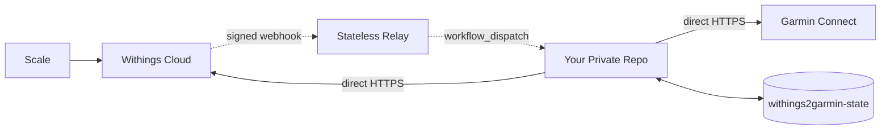

# Withings → Garmin Connect

Automatically sync weigh-ins and body composition from any **Withings Scale** (Body, Body+, Body Smart, Body Scan, Body Comp, Body Cardio) to **Garmin Connect** — 100% free, private, and real-time via GitHub Actions.

**Metrics:** `Weight` · `Body Fat %` · `Muscle Mass` · `Body Water %` · `Bone Mass`

---

## ⚡ Setup in 2 Minutes

### 1. Create your private repository

> [!IMPORTANT]
> Set repository visibility to **Private** to protect your credentials and health data.

---

### 2. Create a Withings App

Open the **[Withings Developer Dashboard](https://developer.withings.com/dashboard/)** → **Create an application**:

| Field | Value to copy-paste |
|---|---|
| **Application Name** | `Withings to Garmin Sync` |
| **Application Description** | `Scale sync to Garmin Connect` |
| **Callback URL** *(exact)* | `https://withings-sync-relay.withings2garmin.workers.dev/oauth` |

Click **Done** and copy your **Client ID** and **Consumer Secret**.

---

### 3. Add 4 GitHub Secrets

In your private repository, go to **Settings → Secrets and variables → Actions → New repository secret**:

| Secret | Value |
|---|---|
| `GARMIN_EMAIL` | Your Garmin Connect email |
| `GARMIN_PASSWORD` | Your Garmin Connect password |
| `WITHINGS_CLIENT_ID` | Client ID from Step 2 |
| `WITHINGS_CLIENT_SECRET` | Consumer Secret from Step 2 |

---

### 4. Install the GitHub App (1 click)

👉 **[Install Relay Withings2Garmin](https://github.com/apps/relay-withings2garmin/installations/new)**

Select **Only select repositories** → pick your private repository → click **Install**.

---

### 5. Authorize Withings (1 click)

1. Go to **Actions → Withings → Garmin Sync → Run workflow** *(leave fields empty — or enter your 6-digit code in `garmin_mfa_code` if Garmin 2FA is active)*.
2. Open the finished run → click **[👉 Authorize Withings Account]** in the **Summary**.
3. Approve on Withings.

> 🎉 **Done!** Your first sync starts automatically and real-time scale sync is now active.

---

<b>❓ Troubleshooting & Options</b>

* **`redirect_uri_mismatch` on Withings:** Ensure the **Callback URL** in your [Withings App](https://developer.withings.com/dashboard/) is set **only** to `https://withings-sync-relay.withings2garmin.workers.dev/oauth` (no trailing `/`, no spaces), save, and wait 30 seconds.
* **Garmin 2FA / MFA:** Enter your current 6-digit verification code in `garmin_mfa_code` when clicking **Run workflow** on the first run. Your session is saved afterward.
* **Show weight values in logs:** Biometric values are masked (`✓ recorded`) by default. To display numbers in your private Action logs, add a repository variable `W2G_SHOW_METRICS` = `true`.

<b>🔒 Security, Privacy & Architecture</b>

* **Zero Health Data on Relay:** The Cloudflare Worker relay is 100% stateless (no database, logs disabled). It only forwards the 1-time OAuth trigger and weigh-in wakeup ping. Health metrics, tokens, and Garmin credentials stay strictly inside your private GitHub runner.
* **Cryptographic Auth:** Repository registration uses **GitHub Actions OIDC** (`id-token: write`) verified against GitHub's JWKS keys, paired with **HMAC-SHA256** signed webhooks verified against your Withings `userid`.
* **Masked Logs & Isolated State:** All tokens are masked via `::add-mask::`, biometric numbers are hidden by default, and rotating tokens are stored on an orphan single-commit branch (`withings2garmin-state`).

---

## ☕ Support & License

If this saved you the cost of a Garmin Index scale:

Distributed under the [MIT License](LICENSE). *Independent open-source tool, not affiliated with Garmin Ltd. or Withings SA.*
