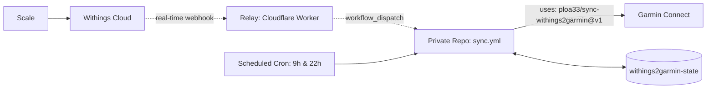

# Withings → Garmin Connect

[](https://github.com/marketplace/actions/withings-to-garmin-connect-sync)
[](https://github.com/ploa33/sync-withings2garmin/releases)
[](https://github.com/ploa33/sync-withings2garmin/actions/workflows/ci.yml)
[](https://buymeacoffee.com/ploa33)

Automatically sync weigh-ins and body metrics from any **Withings Scale** (Body, Body+, Body Smart, Body Scan, Body Comp, Body Cardio) to **Garmin Connect** using GitHub Actions — 100% free, private, and serverless.

**Tracked Metrics:** `Weight` · `Body Fat %` · `Muscle Mass` · `Body Water %` · `Bone Mass`

---

## ⚡ Quick Setup (2 minutes)

### 1. Create your private repository

Click below to generate your private repository from this template:

[](https://github.com/new?template_name=sync-withings2garmin&template_owner=ploa33)

> [!IMPORTANT]
> Keep your repository **Private** to protect your health metrics and credentials.

---

### 2. Get Withings API credentials

In the [Withings Developer Dashboard](https://developer.withings.com/dashboard/), click **Create an application** (or edit existing):

| Field | Value to enter |
|---|---|
| **Application Name** | `Withings to Garmin Sync` |
| **Application Description** | `Scale sync to Garmin Connect` |
| **Registered URLs** | `https://withings-sync-relay.withings2garmin.workers.dev/oauth` |

*(You can also add `https://ploa33.github.io/sync-withings2garmin/` as a fallback — both URLs are supported).*

Click **Done**, then keep your **Client ID** and **Consumer Secret** handy.

---

### 3. Add GitHub Secrets

In your new repository, go to **Settings → Secrets and variables → Actions** → **New repository secret**:

| Secret Name | Value |
|---|---|
| `GARMIN_EMAIL` | Garmin Connect email |
| `GARMIN_PASSWORD` | Garmin Connect password |
| `WITHINGS_CLIENT_ID` | Client ID from Step 2 |
| `WITHINGS_CLIENT_SECRET` | Consumer Secret from Step 2 |

---

### 4. Install the GitHub App (1 click)

Install the companion GitHub App on your private repository:

👉 **[Install Withings Sync GitHub App](https://github.com/apps/sync-withings2garmin/installations/new)**

Select **Only select repositories** → choose your private sync repository → click **Install**.

---

### 5. Authorize & First Sync

1. Go to **Actions → Withings → Garmin Sync → Run workflow** (leave fields empty).
2. Open the completed run → **Summary** tab → click **[👉 Click here to authorise Withings]**.
3. Log in and approve permissions.

> 🎉 **Done!** The relay automatically launches your first sync and activates real-time weigh-in syncing. Your OAuth tokens rotate automatically on every future run. Zero maintenance required.

---

<details>
<summary><b>🔐 Garmin 2-Factor Authentication (2FA / MFA)</b></summary>

If your Garmin account has two-factor authentication enabled:
* When running Step 5 above for the first time, enter your current verification code (TOTP authenticator app or email code) in the **`garmin_mfa_code`** field.
* The session is saved securely to your private state branch — MFA is never needed again.

</details>

<details>
<summary><b>🛠️ Advanced: Without Relay / Self-Hosted Webhook (Google Apps Script)</b></summary>

If you prefer not to install the GitHub App or want to host your own webhook proxy:

1. In Step 2, set your Withings Registered URL to `https://ploa33.github.io/sync-withings2garmin/`.
2. When authorizing, the setup guide will provide a 30-second copy-paste code to enter into `withings_code`.
3. To enable real-time sync with Google Apps Script:
   * Create a Fine-Grained PAT with **Contents: Read & write** permissions.
   * Paste this script in [script.google.com](https://script.google.com/):
   ```javascript
   const REPO  = "YOUR_GITHUB_USERNAME/YOUR_PRIVATE_REPO";
   const TOKEN = "github_pat_...";

   function doPost(e) {
     UrlFetchApp.fetch(`https://api.github.com/repos/${REPO}/dispatches`, {
       method: "post",
       headers: { Authorization: `Bearer ${TOKEN}`, Accept: "application/vnd.github+json" },
       payload: JSON.stringify({ event_type: "withings_sync" }),
       muteHttpExceptions: true,
     });
     return ContentService.createTextOutput("OK");
   }

   function doGet(e) {
     return ContentService.createTextOutput("Withings Webhook Active");
   }
   ```
   * Deploy as **Web app** (Execute as: **Me**, Who has access: **Anyone**).
   * Add the deployed URL as **`WEBHOOK_URL`** in your repository's GitHub Secrets.

</details>

<details>
<summary><b>🏗️ How It Works & Architecture</b></summary>



* **Zero Infrastructure:** Runs entirely on GitHub Actions runners.
* **100% Private:** Biometric health metrics, Garmin credentials, and Withings OAuth tokens never touch the relay — direct communication between your private runner, Withings, and Garmin.
* **Protected Logs:** Biometric health values (weight, fat %, muscle, water, bone) are masked by default in workflow console output and Job Summary.
* **Isolated State:** Tokens and SSO session are saved to an orphan single-commit branch (`withings2garmin-state`) without cluttering git history.
* **Smart De-duplication:** Only uploads weigh-ins newer than the last recorded timestamp.

</details>

---

## ☕ Support

If this saved you the cost of a Garmin Index scale, consider supporting the project:

<a href="https://buymeacoffee.com/ploa33" target="_blank"></a>

## 📄 License & Disclaimer

Distributed under the [MIT License](LICENSE).

*This project is an independent open-source tool and is not affiliated, associated, authorized, endorsed by, or in any way officially connected with Garmin Ltd., Withings SA, or any of their subsidiaries.*
