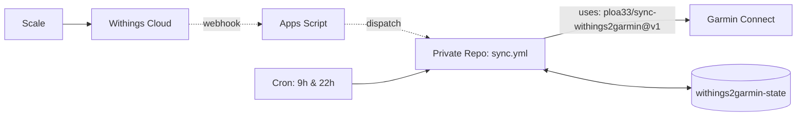

# ⚖️ Withings → Garmin Connect

[](https://github.com/marketplace/actions/withings-to-garmin-connect-sync)
[](https://github.com/ploa33/sync-withings2garmin/releases)
[](https://github.com/ploa33/sync-withings2garmin/actions/workflows/ci.yml)
[](https://buymeacoffee.com/ploa33)

Sync weigh-ins and body metrics from any **Withings Scale** (Body, Body+, Smart, Scan, Comp, Cardio) to **Garmin Connect** in real-time with GitHub, for free.

**Metrics:** Weight, Body Fat %, Muscle Mass, Water %, Bone Mass.

---

## 🚀 Setup (3 minutes)

### 1. Create your private repo

[](https://github.com/new?template_name=sync-withings2garmin&template_owner=ploa33)

👉 **[Click here to create your private repo from this template](https://github.com/new?template_name=sync-withings2garmin&template_owner=ploa33)** *(must be **Private** to protect tokens)*.

### 2. Add Secrets
In your new repository: **Settings → Secrets and variables → Actions**:

| Secret | Value |
|---|---|
| `GARMIN_EMAIL` | Garmin Connect email |
| `GARMIN_PASSWORD` | Garmin Connect password |
| `WITHINGS_CLIENT_ID` | From [Withings Developer Portal](https://developer.withings.com/dashboard/) |
| `WITHINGS_CLIENT_SECRET` | From Withings Developer Portal |
| `WITHINGS_REFRESH_TOKEN` | Initial OAuth token (*see below*) |
| `WEBHOOK_URL` | *(Optional)* Google Apps Script URL for instant sync |

<details>
<summary><b>🔑 Get your WITHINGS_REFRESH_TOKEN (1 min)</b></summary>

1. Open this URL (replace `YOUR_CLIENT_ID` and ensure callback matches your app, e.g. `http://localhost:8080` or `https://example.com`):
   ```text
   https://account.withings.com/oauth2_user/authorize2?response_type=code&client_id=YOUR_CLIENT_ID&state=init&scope=user.metrics,user.info&redirect_uri=http://localhost:8080
   ```
2. Log in, authorize, and copy the `code=` from your browser URL bar.
3. Exchange it:
   ```bash
   curl -X POST https://wbsapi.withings.net/v2/oauth2 \
     -d action=requesttoken -d grant_type=authorization_code \
     -d client_id=YOUR_CLIENT_ID -d client_secret=YOUR_CLIENT_SECRET \
     -d code=YOUR_CODE -d redirect_uri=http://localhost:8080
   ```
4. Copy `refresh_token` into your GitHub Secret.
</details>

### 3. Run
Go to **Actions → Withings → Garmin Sync → Run workflow** (mode `dry-run` or `sync`).

---

## ⚡ Real-Time Sync *(Optional)*

By default, the workflow runs twice daily (09:00 & 22:00) as a safety net. To trigger a sync **instantly** when stepping off the scale:

<details>
<summary><b>Setup Google Apps Script Webhook Relay (2 min)</b></summary>

Withings sends a webhook when a new weigh-in occurs, and Google Apps Script acts as a free, serverless bridge to trigger your GitHub Actions workflow:

1. **GitHub Token:** Create a [Fine-Grained PAT](https://github.com/settings/personal-access-tokens/new):
   - Repository access: **Only select repositories** → choose your private sync repository.
   - Permissions: **Repository permissions → Contents: Read and write**.
2. **Google Apps Script:** Open [script.google.com](https://script.google.com/) → **New project**, replace the code with:
   ```javascript
   const REPO = "YOUR_GITHUB_USERNAME/YOUR_PRIVATE_REPO"; // e.g. "ploa33/withings2garmin"
   const TOKEN = "github_pat_11A...";                    // Your Fine-Grained PAT from step 1

   function doPost(e) {
     UrlFetchApp.fetch(`https://api.github.com/repos/${REPO}/dispatches`, {
       method: "post",
       headers: {
         Authorization: `Bearer ${TOKEN}`,
         Accept: "application/vnd.github+json"
       },
       payload: JSON.stringify({ event_type: "withings_sync" }),
       muteHttpExceptions: true,
     });
     return ContentService.createTextOutput("OK");
   }

   function doGet(e) {
     return ContentService.createTextOutput("Withings2Garmin Webhook Relay Active");
   }
   ```
3. **Deploy:** Click **Deploy → New deployment**:
   - Type: **Web app** (gear icon)
   - Execute as: **Me**
   - Who has access: **Anyone** *(required so Withings servers can post to it)*
   - Click **Deploy** and copy the **Web app URL** (`https://script.google.com/macros/s/.../exec`).
4. **Secret:** In your private repo, add the URL as the **`WEBHOOK_URL`** secret.

*That's it! On the next run, the action automatically registers this URL with Withings Notify API.*
</details>

---

## 🛠️ How it works & Updates



- **Zero Maintenance:** Your repository calls `ploa33/sync-withings2garmin@v1`. When upstream releases fixes (`v1.x.y`), you get them automatically on the next run.
- **De-duplication:** Only weigh-ins newer than the last recorded checkpoint are uploaded.
- **Safe State:** OAuth tokens and Garmin SSO session persist on a dedicated single-commit `withings2garmin-state` branch without polluting your commit history.

---

## ☕ Support
If this saved you the cost of a Garmin Index scale, consider supporting the project:

<a href="https://buymeacoffee.com/ploa33" target="_blank"></a>

## 📄 License
[MIT](LICENSE)
