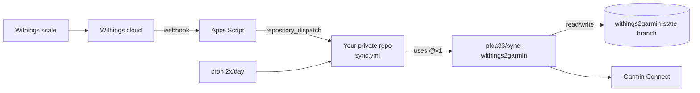

# ⚖️ Withings → Garmin Connect

[](https://github.com/ploa33/sync-withings2garmin/actions/workflows/ci.yml)
[](https://github.com/ploa33/sync-withings2garmin/releases)
[](https://buymeacoffee.com/ploa33)

Sync weigh-ins and body composition from any **Withings smart scale** (Body, Body+, Body Smart, Body Scan, Body Comp, Body Cardio) to **Garmin Connect** — in real time (< 30 s) if you want. 100 % GitHub Actions: no server, free.

**Synced metrics:** weight, body fat %, muscle mass, body water %, bone mass.

---

## 🚀 Setup (5 minutes)

### 1. Create your private copy

[](https://github.com/new?template_name=sync-withings2garmin&template_owner=ploa33)

👉 **[Cliquez ici pour créer votre dépôt privé depuis ce template](https://github.com/new?template_name=sync-withings2garmin&template_owner=ploa33)**  
*(ou cliquez sur le bouton vert **`Use this template`** sur [le dépôt GitHub](https://github.com/ploa33/sync-withings2garmin), puis choisissez **Private**)*.

> [!IMPORTANT]
> Your repository **must be private**: your Withings and Garmin session tokens are stored in it (on the `withings2garmin-state` branch).

Your copy only needs [`.github/workflows/sync.yml`](.github/workflows/sync.yml). Everything else (`src/`, `tests/`, …) can be deleted: the sync engine is loaded from `ploa33/sync-withings2garmin@v1` at every run, so **you receive fixes automatically**.

### 2. Add your secrets
In your repository: **Settings → Secrets and variables → Actions → New repository secret**

| Secret | Value |
|---|---|
| `GARMIN_EMAIL` | Garmin Connect email |
| `GARMIN_PASSWORD` | Garmin Connect password |
| `WITHINGS_CLIENT_ID` | From the [Withings Developer Portal](https://developer.withings.com/) (create an app, callback URL: `https://example.com`) |
| `WITHINGS_CLIENT_SECRET` | Same place |
| `WITHINGS_REFRESH_TOKEN` | Initial token, see below — only used on the first run |
| `WEBHOOK_URL` | *(optional)* real-time sync, see below |

<details>
<summary><b>🔑 How to get <code>WITHINGS_REFRESH_TOKEN</code></b></summary>

1. Open this URL (replace `YOUR_CLIENT_ID`), log in and authorize:
   ```text
   https://account.withings.com/oauth2_user/authorize2?response_type=code&client_id=YOUR_CLIENT_ID&state=init&scope=user.metrics,user.info&redirect_uri=https://example.com
   ```
2. Copy the `code=` value from the address bar of the page you are redirected to (it expires after 30 s).
3. Exchange it:
   ```bash
   curl -X POST https://wbsapi.withings.net/v2/oauth2 \
     -d action=requesttoken -d grant_type=authorization_code \
     -d client_id=YOUR_CLIENT_ID -d client_secret=YOUR_CLIENT_SECRET \
     -d code=YOUR_CODE -d redirect_uri=https://example.com
   ```
4. Save the `refresh_token` from the response as the `WITHINGS_REFRESH_TOKEN` secret.
</details>

### 3. Test
**Actions → Withings → Garmin Sync → Run workflow**, mode `dry-run` (shows your recent weigh-ins without uploading anything), then `sync`.

That's it. The workflow runs twice a day (09:00 and 22:00 Paris time) and catches up any missed weigh-in.

---

## ⚡ Real-time sync *(optional)*

<details>
<summary><b>Google Apps Script webhook (sync &lt; 30 s after stepping off the scale)</b></summary>

1. Create a [fine-grained token](https://github.com/settings/personal-access-tokens/new) limited to your private repository with **Contents: Read and write**.
2. Create a project on [Google Apps Script](https://script.google.com/) and paste (fill in your values):
   ```javascript
   const REPO = "YOUR_GITHUB_USER/YOUR_PRIVATE_REPO";
   const TOKEN = "github_pat_...";

   function doPost(e) {
     UrlFetchApp.fetch(`https://api.github.com/repos/${REPO}/dispatches`, {
       method: "post",
       headers: { Authorization: `Bearer ${TOKEN}`, Accept: "application/vnd.github+json" },
       payload: JSON.stringify({ event_type: "withings_sync" }),
       muteHttpExceptions: true,
     });
     return ContentService.createTextOutput("OK");
   }
   function doGet() { return ContentService.createTextOutput("Active"); }
   ```
3. **Deploy → New deployment → Web app** (Execute as: *Me*, Who has access: *Anyone*).
4. Save the deployment URL as the `WEBHOOK_URL` secret. The next run subscribes it to Withings automatically.
</details>

---

## ⚙️ Options

All inputs of the action (edit `with:` in your `sync.yml`):

| Input | Default | Description |
|---|---|---|
| `mode` | `sync` | `sync` · `dry-run` (fetch only) · `simulate` (uploads one **fake** weigh-in to test Garmin) |
| `lookback-days` | `30` | How far back to look for weigh-ins not yet synced |
| `force-resync` | `false` | Ignore the checkpoint and re-upload every weigh-in in the window |
| `state-branch` | `withings2garmin-state` | Branch storing tokens and sync state |

---

## 🔄 Updates

- **Fixes and improvements** (`v1.x.y`) reach you automatically: your workflow uses `@v1`.
- **Major versions** (`v2`, …) may require a change on your side: Dependabot opens a pull request in your repository.
- Prefer full control? Pin a commit: `uses: ploa33/sync-withings2garmin@<commit-sha>`.

---

## 🛟 Troubleshooting

| Symptom | Fix |
|---|---|
| `Withings token refresh failed (status=…)` | Generate a new refresh token (see above), update `WITHINGS_REFRESH_TOKEN`, then delete the `withings2garmin-state` branch. |
| Garmin login fails / MFA | Delete `garth_session/` on the `withings2garmin-state` branch and re-run (a fresh Garmin login is done). |
| Push to state branch denied | Check **Settings → Actions → General → Workflow permissions** isn't restricted by an organization policy. |

<details>
<summary><b>How it works</b></summary>



- The state branch always holds a **single commit** (tokens, Garmin session, last synced timestamp): no token history accumulates and your `main` branch stays clean.
- Only weigh-ins newer than the last synced one are uploaded: no duplicates in Garmin.
- State is saved even when a run fails, so the rotating Withings refresh token is never lost.
</details>

<details>
<summary><b>Run locally</b></summary>

```bash
pip install -r requirements.txt
export WITHINGS_CLIENT_ID=... WITHINGS_CLIENT_SECRET=... WITHINGS_REFRESH_TOKEN=...
export GARMIN_EMAIL=... GARMIN_PASSWORD=...
export W2G_STATE_DIR=.state
python src/sync.py --dry-run
```
⚠️ A local token refresh rotates the Withings refresh token: the one stored on the state branch may stop working. Prefer `dry-run` from the Actions tab.
</details>

---

## ☕ Support

If this saved you the price of a Garmin Index scale, consider buying me a coffee!

<a href="https://buymeacoffee.com/ploa33" target="_blank"></a>

## 📄 License

[MIT](LICENSE)
