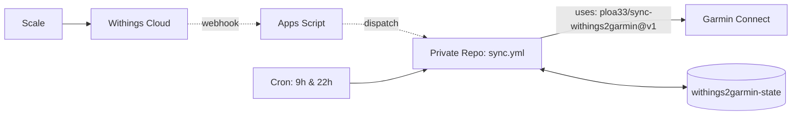

# Withings → Garmin Connect

[](https://github.com/marketplace/actions/withings-to-garmin-connect-sync)
[](https://github.com/ploa33/sync-withings2garmin/releases)
[](https://github.com/ploa33/sync-withings2garmin/actions/workflows/ci.yml)
[](https://buymeacoffee.com/ploa33)

Sync weigh-ins and body metrics from any **Withings Scale** (Body, Body+, Smart, Scan, Comp, Cardio) to **Garmin Connect** in real-time with GitHub, for free.

**Metrics:** Weight, Body Fat %, Muscle Mass, Water %, Bone Mass.

---

## Setup (5 minutes)

### 1. Create your private repo

[](https://github.com/new?template_name=sync-withings2garmin&template_owner=ploa33)

*(must be **Private** to protect your credentials).*

### 2. Add Secrets
In your new repository: **Settings → Secrets and variables → Actions**:

| Secret | Value |
|---|---|
| `GARMIN_EMAIL` | Garmin Connect email |
| `GARMIN_PASSWORD` | Garmin Connect password |
| `WITHINGS_CLIENT_ID` | From [Withings Developer Portal](https://developer.withings.com/dashboard/) |
| `WITHINGS_CLIENT_SECRET` | From Withings Developer Portal |
| `WEBHOOK_URL` | *(Optional)* Google Apps Script URL for instant sync |

> **No `WITHINGS_REFRESH_TOKEN` needed.** The action handles the full OAuth flow for you in the next step.

### 3. First Run — Authorize Withings (no curl, no terminal)

Go to **Actions → Withings → Garmin Sync → Run workflow**.

**If this is your first run**, the action will display a step-by-step guide directly in the **Job Summary** tab with a one-click Withings authorization link.

Follow the guide (2 steps total):

1. **Run the workflow once** (leave all fields empty). Open the completed run → **Summary** tab → click the Withings auth link → log in and authorize.
2. **Copy the `code=`** value from your browser's address bar, then **Run the workflow again** and paste it in the **`withings_code`** field.

The action exchanges the code, saves tokens to the `withings2garmin-state` branch, and syncs your first weigh-in. **Done — tokens rotate automatically from now on.**

<details>
<summary><b>🔐 Garmin 2FA (MFA) — first login</b></summary>

If your Garmin account has **2-factor authentication enabled**, you will need to provide your MFA code once (the SSO session is then persisted in the state branch).

On the second run (step 2 above), also fill in the **`garmin_mfa_code`** field with your current TOTP or email OTP code.

</details>

---

## ⚡ Real-Time Sync *(Optional)*

By default, the workflow runs twice daily (09:00 & 22:00) as a safety net. To trigger a sync **instantly** when stepping off the scale:

<details>
<summary><b>Setup Google Apps Script Webhook Relay (2 min)</b></summary>

Withings sends a webhook when a new weigh-in occurs, and Google Apps Script acts as a free, serverless bridge to trigger your GitHub Actions workflow.

1. **GitHub Token:** Create a [Fine-Grained PAT](https://github.com/settings/personal-access-tokens/new):
   - Repository access: **Only select repositories** → choose your private sync repository.
   - Permissions: **Repository permissions → Contents: Read and write**.
   - **⚠️ Set expiration to `1 year` (or `No expiration`).** The default is 30 days — if you forget to renew it, real-time sync silently stops working.

2. **Google Apps Script:** Open [script.google.com](https://script.google.com/) → **New project**, replace the code with:
   ```javascript
   const REPO  = "YOUR_GITHUB_USERNAME/YOUR_PRIVATE_REPO"; // e.g. "ploa33/withings2garmin"
   const TOKEN = "github_pat_11A...";                      // Fine-Grained PAT from step 1

   // doPost: called by Withings on every new weigh-in → triggers the GitHub Action.
   function doPost(e) {
     UrlFetchApp.fetch(`https://api.github.com/repos/${REPO}/dispatches`, {
       method: "post",
       headers: { Authorization: `Bearer ${TOKEN}`, Accept: "application/vnd.github+json" },
       payload: JSON.stringify({ event_type: "withings_sync" }),
       muteHttpExceptions: true,
     });
     return ContentService.createTextOutput("OK");
   }

   // doGet: also handles the Withings OAuth callback during initial setup.
   // If Withings redirects here with ?code=..., it forwards the code to the
   // GitHub Action, which exchanges it automatically — zero copy-paste needed.
   function doGet(e) {
     const code = e && e.parameter && e.parameter.code;
     if (code) {
       UrlFetchApp.fetch(`https://api.github.com/repos/${REPO}/dispatches`, {
         method: "post",
         headers: { Authorization: `Bearer ${TOKEN}`, Accept: "application/vnd.github+json" },
         payload: JSON.stringify({ event_type: "withings_sync", client_payload: { code } }),
         muteHttpExceptions: true,
       });
       return ContentService.createTextOutput(
         "✅ Withings authorized! Your GitHub Action will now exchange the code and sync. You can close this tab."
       );
     }
     return ContentService.createTextOutput("Withings2Garmin Webhook Relay Active");
   }
   ```

3. **Deploy:** Click **Deploy → New deployment**:
   - Type: **Web app** (gear icon)
   - Execute as: **Me**
   - Who has access: **Anyone** *(required so Withings servers can call it)*
   - Click **Deploy** and copy the **Web app URL** (`https://script.google.com/macros/s/.../exec`).

4. **Secret:** In your private repo, add the URL as the **`WEBHOOK_URL`** secret.

*That's it! On the next run, the action automatically registers this URL with Withings Notify API.*

> **Bonus:** If you set your GAS URL as the **redirect URI** in your Withings developer app, the very first OAuth authorization will trigger the action automatically — no copy-paste of the `code=` needed at all.

</details>

---

## 🛠️ How it works & Updates



- **Zero Maintenance:** Your repository calls `ploa33/sync-withings2garmin@v1`. When upstream releases fixes (`v1.x.y`), you get them automatically on the next run.
- **De-duplication:** Only weigh-ins newer than the last recorded checkpoint are uploaded.
- **Safe State:** OAuth tokens and Garmin SSO session persist on a dedicated single-commit `withings2garmin-state` branch without polluting your commit history.

---

## 🔒 Privacy & Self-Hosted

- **100% Self-Hosted:** Everything runs inside your own private GitHub repository and GitHub-hosted Actions runners.
- **Zero Third-Party Servers:** Your Garmin credentials, Withings tokens, and health metrics are never transmitted to any third-party backend, proxy, or database.
- **Strictly Isolated State:** Tokens and SSO session cookies are saved exclusively inside your own private repository's `withings2garmin-state` branch.

---

## ☕ Support
If this saved you the cost of a Garmin Index scale, consider supporting the project:

<a href="https://buymeacoffee.com/ploa33" target="_blank"></a>

## 📄 License
[MIT](LICENSE)

---

## ⚖️ Legal Disclaimer
This project is an independent open-source tool and is not affiliated, associated, authorized, endorsed by, or in any way officially connected with Garmin Ltd., Withings S.A., or any of their subsidiaries or affiliates. All product and company names are trademarks™ or registered® trademarks of their respective holders.
